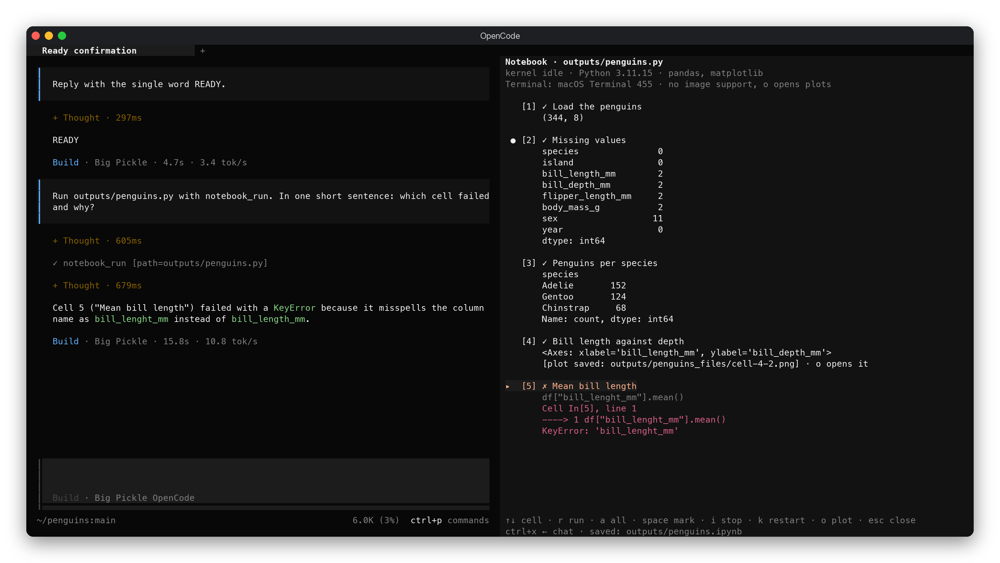

# opencode-notebook

A Jupyter-style notebook inside [OpenCode](https://opencode.ai). The notebook
opens in a panel next to the chat, and you run its cells there with a key. The
agent uses the same live Python kernel: it can run cells, and read the cells you
point it to, with their outputs.



*Rendered from the real TUI: the agent ran the notebook and explained the cell
that failed; cell 2 is marked for it to read.*

## What you get

- **A notebook panel**: `/notebook outputs/analysis.py` opens it beside the
  chat. Each cell shows its run number, its state (running, queued, ✓, ✗,
  edited since it ran) and its output; errors are cut down to the line in your
  notebook that failed.
- **One live kernel**, as in Jupyter: variables stay between cells, for you and
  for the agent, and you see the agent's runs as they happen.
- **`notebook_run`**: the agent runs cells and gets back a short report of the
  outputs and errors, sized for small context windows.
- **`notebook_read`**: the agent reads the cells you marked with `space` in the
  panel, or the ones you name ("look at cell 3"), with their latest outputs,
  including cells you ran yourself. Nothing is marked? It only gets the list of
  cells.
- **Saved as you go**: after every run, `analysis.ipynb` with all outputs, for
  Jupyter or VS Code, and every plot as a PNG in `analysis_files/`.
- **Plots**: `o` opens the selected cell's plot in your image viewer. In
  terminals that report Kitty or Sixel graphics (Ghostty, kitty, WezTerm,
  iTerm2, VS Code with *Terminal › Integrated: Enable Images*) the panel also
  draws it inline. The top of the panel says which terminal you are in and
  which of the two you get.

Works with OpenCode **2.0.29 or later**. Needs [uv](https://docs.astral.sh/uv/),
which starts the kernel with the packages each notebook asks for.

## Install

Clone a release into a project's `.opencode/plugins/` folder; OpenCode loads
plugins from there by itself:

```bash
git -c advice.detachedHead=false clone -q --depth 1 --branch v0.1.6 https://github.com/dskanakoglou/opencode-notebook .opencode/plugins/opencode-notebook
```

For every project, clone it anywhere and list the folder in your global
`~/.config/opencode/opencode.json`:

```json
{ "plugins": ["/absolute/path/to/opencode-notebook"] }
```

Restart OpenCode afterwards. Nothing needs building or `npm install`; OpenCode
compiles the plugin itself.

**Not with a `github:` entry for now.** On OpenCode 2.0.29 a plugin installed
as `"github:dskanakoglou/opencode-notebook#v0.1.6"` loads, but its panel is
drawn once and never updates. Loaded from a folder it works.

The first notebook you run downloads Jupyter's kernel packages and the ones the
notebook lists (about 400 MB with pandas and matplotlib) into uv's cache; after
that a kernel starts in seconds.

## A notebook is a `.py` file

Cells start with `# %%`, as in VS Code, Spyder and Jupytext. Packages go in a
[PEP 723](https://peps.python.org/pep-0723/) block at the top:

```python
# /// script
# dependencies = ["pandas", "matplotlib"]
# ///

# %% Load the penguins
import pandas as pd
df = pd.read_csv("penguins.csv")
df.shape

# %% [markdown]
# Text cells start with `# %% [markdown]`.

# %% Missing values
df.isna().sum()
```

The text after `# %%` is the cell's title in the panel. A plain `.py` file reads
well in a diff, and models write it far more reliably than `.ipynb` JSON. You or
the agent edit it as a normal file, so the agent's edits go through OpenCode's
usual approval. The panel follows the file as it changes, and marks a cell
*edited since it ran* when its output is out of date.

## The panel

| Key | |
|---|---|
| `↑` `↓` | Select a cell |
| `r` or `enter` | Run the selected cell |
| `a` | Run all; stops at the first error, as Jupyter does |
| `space` | Mark or unmark the cell for `notebook_read` |
| `i` | Stop the running cell; queued cells are cancelled |
| `k` | Restart the kernel: variables are gone, outputs stay until cells run again |
| `o` | Open the selected cell's plot |
| `pgup` `pgdn` | Scroll; the selected cell shows its whole output, the others their first lines |
| `esc` | Close the panel |
| `ctrl+x ←` / `ctrl+x →` | Move between the chat and the panel |

Open it with `/notebook <path>`, or `/notebook` (press enter twice) for the last
one. It needs an open conversation. With a path argument the notebook can be
anywhere in the project.

The panel takes the place of the sidebar while it is open; `esc` brings the
sidebar back. [Sidebar Plus](https://github.com/dskanakoglou/opencode-sidebar-plus)
v0.3.1 and later knows this and does not say "sidebar hidden" meanwhile.

## The agent's tools

**Plugin tools do not go through OpenCode's approval prompt**, even under an
`ask` rule. `notebook_run` executes code, so it only runs notebooks under the
folders in the `roots` option, by default `outputs/`. To turn it off for an
agent or for everything, deny it; it then disappears from the agent's tools:

```json
{ "permissions": [{ "action": "notebook_run", "resource": "*", "effect": "deny" }] }
```

With `notebook_run` denied you still run cells yourself, and the agent can still
read them with `notebook_read`, which runs nothing. Everything the agent reads
is sent to its model provider, so mark only what may leave your machine.

## Options

On an object entry in `opencode.json`:

```json
{
  "plugins": [
    { "package": "/absolute/path/to/opencode-notebook", "options": { "roots": ["outputs", "analysis"] } }
  ]
}
```

| Option | Default | Meaning |
|---|---|---|
| `roots` | `["outputs"]` | Folders, relative to the project, where `notebook_run` may run notebooks |

## How it works

The plugin has two halves. `server.ts` runs in OpenCode's server: it owns the
kernels, gives the agent its two tools and answers the panel. `tui.tsx` is the
panel. They talk over OpenCode's plugin RPC, so the agent and you share one
kernel per notebook.

Each kernel is a real Jupyter kernel (`ipykernel`), started through
`uv run --with jupyter_client --with ipykernel --with <your packages>` by
[`kernel/bridge.py`](kernel/bridge.py), on Unix sockets in a private folder
rather than TCP. A kernel restarts by itself when the notebook's package list
changes. Kernels stop when OpenCode closes.

`.ipynb` files are written next to the `.py`; one that this plugin did not write
is never overwritten (it writes `analysis.opencode.ipynb` instead).

## Limitations

- Python only. Cells are edited as a file, not typed into the panel.
- Marks are by cell number: if cells are added above a marked one, the mark
  stays on the number.
- Inline plots have not yet been tried in a terminal with Kitty or Sixel
  graphics; `o` works everywhere.
- Not yet tried on Windows.

## Development

```bash
npm install
npm test        # unit tests
npm run check   # type check
```

Point a test project's `opencode.json` at your working copy:
`{ "plugins": ["/absolute/path/to/opencode-notebook"] }`.

## License

MIT
